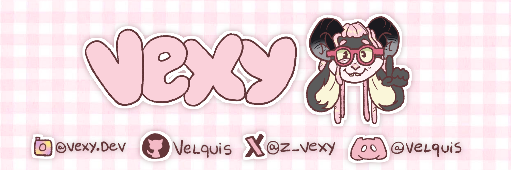
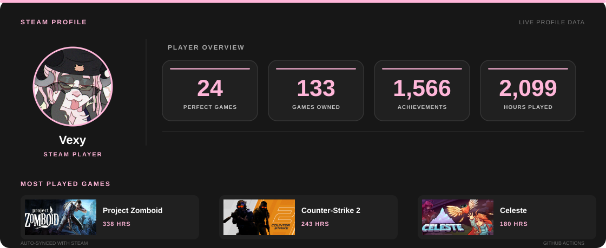

*I don't like to program but I need it unfortunately*

## About Me

- Software Engineering student.
- Project Zomboid addict.
- I like databases and backend stuff.
- idk what to put in here :P.
- I have a 40-hour Spotify playlist.

*i code for fun sometimes, sooooooo yeah, kinda having fun idk*

## Languages & Tools

*i use those things, not all the time but yeah u got it*.

## Steam stats

ㅤ
ㅤㅤㅤ

ㅤ

*`[bruh i play alot of project zomboid, WE HAVE VERTICAL LADDERS!!! (click on STEAM button to see my steam profile btw)]`*

## Find Me

  

*`[ Click on the icons to go to each social network respective to that image, except Discord, it is the name itself ]`*

